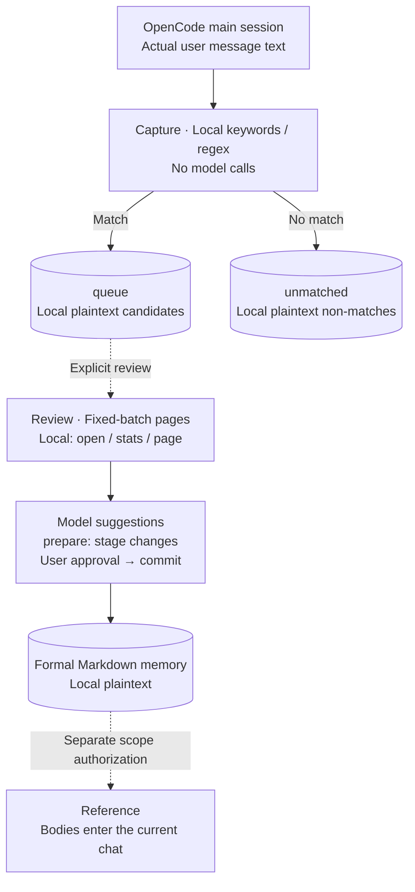

# Personal Memory

[简体中文](README.md) · **English**

**Local personal memory for OpenCode v1. Capture with rules, review in batches, recall with permission.**

Keep preferences and project conventions across conversations without asking a model to process every message for memory. A small plugin collects candidates using local keywords and regexes. You decide what becomes lasting memory and when the model may read it.

**Current version: v0.3.1** — adds Chinese and English READMEs, English operating documentation and bilingual starter rules. It retains v0.3.0's fixed-batch review, paged records, rule comparison, unmatched-record rescanning and post-lock pause check.

[Why use it](#why-use-it) · [How it works](#how-it-works) · [Scope and limitations](#scope-and-limitations) · [Install](#install) · [Usage](#usage) · [Documentation](#documentation)

## Why use it

- **No model calls for capture.** Keywords and regexes collect candidates locally. Review, rule learning and recall use the model you already run through OpenCode; routine capture does not add a model call per message.
- **Review at your own pace.** Start with counts, then read complete records by page. New messages stay out of the batch you opened. Preview a rule change before applying it.
- **Choose what the model reads.** Reference general memory or a named project when needed. Private fields need separate approval for each field and purpose, every time. Existing memory is not automatically injected into new conversations.
- **Few moving parts.** One TypeScript plugin and Python standard-library scripts; Markdown for formal memory, JSON/JSONL for rules and candidates. No vector database, memory server, extra model account or embedding service.

Capture and local maintenance make no model calls. The skill description and instructions still occupy context; review and recall consume tokens.

## How it works



Capture runs automatically; you initiate review and reference. Candidates are not confirmed facts. Reviewing unmatched records or comparing rules does not automatically move records, change rules or delete sources.

## Scope and limitations

This is for **one person using OpenCode v1**, keeping preferences and project conventions across sessions, and willing to review them occasionally. If you want semantic search, fully automatic extraction, team memory or multi-device synchronization, choose a tool built for that workflow.

| Requirement | Current scope |
|---|---|
| OpenCode | v1 plugin/SDK interfaces; development baseline **v1.18.32**. Use that version or a newer v1. Earlier versions are unverified. No v2, Claude Code or Codex integration. |
| Python | Python 3, standard library only; development used **Python 3.12**. Other Python versions have not been established as a supported minimum. |
| Operating system | Development and automated checks ran on **Linux**. The code includes macOS/POSIX and Windows branches, but macOS and Windows have not been verified on real machines. |
| Languages | Chinese and English request cues and starter rules. Operating instructions are in English; replies should follow your language. Rules can be adapted for other languages. |

Trade-offs to know before installing:

- Rules miss paraphrases and can match quotations, temporary requests or negations. Chinese/English starter rules are examples, not semantic understanding.
- Review takes attention. Nothing automatically turns the whole conversation into an accurate personal profile.
- Each captured message starts a local Python process and performs file I/O. No model call does not mean no runtime cost.
- The private-field helper can replace existing fields, but cannot create a private file or add a new field. It is not a password manager.
- Automated checks use synthetic data and a fake SDK client. They do not establish a complete real OpenCode installation/provider workflow.

### Where your words go

**Capture stores text locally, including misses.** Eligible main-session user messages may enter either `learning/learning_queue.jsonl` or `learning/unmatched.jsonl`; a rule miss is not a “do not store” decision. Pause before a conversation you do not want copied into these files. Sub-session, synthetic and unknown-source messages are excluded by the plugin.

Memory and candidates are **plaintext**. The project itself has no cloud sync or telemetry. When you authorize review or reference, the permitted text enters your OpenCode conversation and may be sent to your configured model provider. Local file permissions do not protect against administrators, and cancelling reference cannot retract content already sent. See [Security and privacy](SECURITY.md).

## Install

Use the OpenCode **v1** installation layout below. OpenCode loads the TypeScript plugin through its runtime; Python must also be available on `PATH`. Bun is needed separately only if you want to run the repository's plugin tests.

Clone into a directory named `personal-memory`, or download the ZIP and rename the extracted directory to `personal-memory`:

```sh
git clone https://github.com/WantexZard/personal-memory-public.git personal-memory
```

Run the following from the **parent directory of the checkout**. These steps copy code, instructions and starter templates, not `.git`, tests or runtime memory.

### Linux / macOS shell

The default configuration directory is `~/.config/opencode`. Set `PM_CONFIG` to your actual directory if it differs.

```sh
PM_CONFIG="${XDG_CONFIG_HOME:-$HOME/.config}/opencode"
PM="$PM_CONFIG/skills/personal-memory"
mkdir -p "$PM" "$PM_CONFIG/plugins"

cp personal-memory/.gitignore personal-memory/LICENSE personal-memory/CONTRIBUTING.md \
   personal-memory/SKILL.md personal-memory/README*.md \
   personal-memory/SECURITY.md personal-memory/capture.py \
   personal-memory/memory_ops.py personal-memory/workflow.py "$PM/"
cp -R personal-memory/examples personal-memory/references \
      personal-memory/playbooks personal-memory/scripts "$PM/"
cp personal-memory/plugin/personal-memory-capture.ts "$PM_CONFIG/plugins/"

python3 -B "$PM/scripts/init.py"
python3 -B "$PM/memory_ops.py" status
```

<details>
<summary>Windows PowerShell</summary>

The layout is the same. Adjust `$PM_CONFIG` if your OpenCode configuration lives elsewhere. Windows support is not yet real-machine verified.

```powershell
$PM_CONFIG = Join-Path $env:USERPROFILE ".config\opencode"
$PM = Join-Path $PM_CONFIG "skills\personal-memory"
New-Item -ItemType Directory -Force $PM, "$PM_CONFIG\plugins" | Out-Null

Copy-Item personal-memory\.gitignore, personal-memory\LICENSE, personal-memory\CONTRIBUTING.md, `
  personal-memory\SKILL.md, personal-memory\README*.md, `
  personal-memory\SECURITY.md, personal-memory\capture.py, `
  personal-memory\memory_ops.py, personal-memory\workflow.py -Destination $PM
Copy-Item personal-memory\examples, personal-memory\references, `
  personal-memory\playbooks, personal-memory\scripts -Destination $PM -Recurse -Force
Copy-Item personal-memory\plugin\personal-memory-capture.ts "$PM_CONFIG\plugins\"

python -B "$PM\scripts\init.py"
python -B "$PM\memory_ops.py" status
```

</details>

The initializer creates `learning/rules.json` and `user-profile/public.md` / `private.md` without overwriting existing files. **Run it before using capture** unless you have already supplied valid rules. Keep `playbooks/` for the linked learning workflows.

**Restart OpenCode** after installing the plugin. Then try a synthetic example such as “Remember this: the demo project's accent color is orange”, and ask to review memory. `status` checks backend metadata; it does not by itself prove the plugin captured a message.

<details>
<summary>Custom paths or Python interpreter</summary>

The plugin expects `plugins/` and `skills/personal-memory/` under the same configuration root. For another layout or interpreter, set these variables **before starting OpenCode**:

```sh
export PERSONAL_MEMORY_SCRIPT="/path/to/skills/personal-memory/capture.py"
export PERSONAL_MEMORY_PYTHON="python3"
```

On Windows, use `python` or an absolute interpreter path via the corresponding environment variables.

</details>

### Updating an existing installation

Replace the same code/plugin files from a fresh checkout and restart OpenCode. **Keep your `learning/` and `user-profile/` directories.** Running `init.py` again does not replace existing rules or memory, so the new English starter rules will not silently modify an established `learning/rules.json`. Ask OpenCode to propose the additions and use the normal rule-approval workflow if you want them.

## Usage

Use ordinary language; the commands below are examples, not a required command syntax.

| Say | Result |
|---|---|
| “Remember this: the demo project's accent color is orange.” | A matching message becomes a candidate, not formal memory. |
| “Review memory in batches.” | The model reads an authorized queue batch and proposes Add / Update / Remove / Conflict / Skip. You approve the final changes. |
| “Show public memory.” | Read general memory into this task. `public` is an internal name, not permission to publish it. |
| “Reference Project A for this session.” | Read that named topic as needed until cancellation or session end. |
| “Rescan unmatched records; show counts only.” | Preview matches within an authorized unmatched batch without outputting candidate bodies. |
| “Learn capture rules.” | Inspect authorized unmatched records and propose rule changes; apply them only after approval. |
| “Check memory status.” | Return counts and state, not candidate or memory bodies. |
| “Pause capture.” / “Resume capture.” | Create/remove `learning/.paused`. |

### Batched review and rule previews

`workflow.py` (introduced in v0.3.0) opens a fixed batch before paging. Later arrivals are counted separately; they do not alter the batch you are reviewing. Pages return complete records, up to 50 items and 40 KiB of JSON. A record that cannot fit is withheld from the page with an error, not cut into a misleading fragment.

`compare-rules` previews a full draft rules object; `rescan` checks an unmatched batch against current or draft rules. Both preview only: no automatic acceptance, source cleanup or queue movement. Comparison metadata is saved under `learning/review-worksets/`, without a separate copy of candidate bodies. Worksets are not automatically cleaned up.

OpenCode follows the [batched workflow reference](references/workflow.md). Statistics-only permission does not include candidate bodies. Accepted memory and rule changes still use **prepare → your approval → commit**.

### Pause capture

Ask OpenCode to pause, or use the marker directly:

```sh
touch "$PM/learning/.paused"  # Pause
rm "$PM/learning/.paused"     # Resume
```

```powershell
New-Item -ItemType File -Force "$PM\learning\.paused" # Pause
Remove-Item "$PM\learning\.paused"                   # Resume
```

`$PM` is the skill directory set during installation. No restart is needed. Capture checks the marker before and after taking the lock; an event already processing past those checks can still finish. Pausing does not erase old data, stop OpenCode's own history or backfill messages when resumed. `status.capture_paused` reports the marker's state.

### Local retention

```sh
python3 -B "$PM/memory_ops.py" maintain
```

Maintenance prunes unmatched records to 30 days / 10,000 rows / 10 MiB, removes archive bodies after 90 days while retaining ID tombstones, and bounds diagnostic logs. Capture also prunes unmatched records when writing a new unmatched record; matched messages do not trigger this cleanup. There is no resident maintenance service: use `maintain` yourself or schedule it with your OS if you want cleanup during quiet periods.

## Documentation

| File | Purpose |
|---|---|
| [SKILL.md](SKILL.md) | Agent instructions, request cues and authorization workflow |
| [CLI reference](references/cli.md) | Backend commands, stdin formats and error codes |
| [Batched workflow](references/workflow.md) | Fixed batches, pagination, rule comparison and rescanning |
| [First rule learning](playbooks/initialization.md) | Optional rule-initialization workflow; separate from file setup |
| [Rule-learning playbook](playbooks/rule-learning-lite.md) | A short recipe for proposing rule changes |
| [Security](SECURITY.md) | Plaintext storage, permissions and provider boundaries |
| [Contributing](CONTRIBUTING.md) | Development and synthetic-test commands |

README is available in Chinese and English. Agent instructions and operating references are maintained as a single English set, with bilingual request cues and starter rules. Code identifiers and CLI commands are unchanged.

Your runtime data lives in `learning/` and `user-profile/` under the installed skill. Both are ignored by Git. **Do not include them in issues, pull requests or a published copy.**

## License

[MIT](LICENSE).
