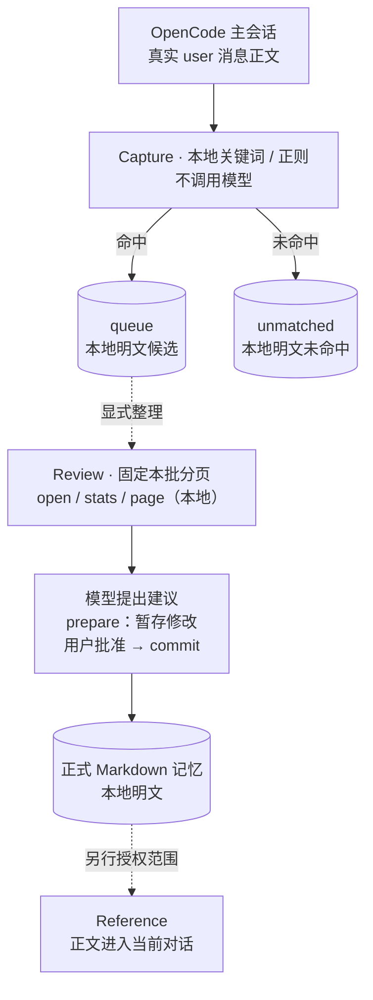

# Personal Memory

**简体中文** · [English](README.en.md)

**给 OpenCode v1 用的本地个人记忆：规则采集，分批整理，按需参考。**

偏好和项目约定不用每开一轮对话就重说。Personal Memory 用本地关键词和正则收集候选，你决定哪些值得长期保留，以及什么时候读给模型。

**当前版本：v0.3.1** — 新增中英双语首页、英文操作文档与中英起步规则；保留 v0.3.0 的固定批次整理、完整记录分页、规则对比、未命中回扫及取锁后的暂停复查。

[项目优势](#项目优势) · [工作原理](#工作原理) · [适用范围与限制](#适用范围与限制) · [安装](#安装) · [日常使用](#日常使用) · [文档](#文档)

## 项目优势

- **采集不调模型。** 本地规则收集候选，不为每条消息增加一次模型调用。需要整理、学习规则或参考记忆时，才使用你在 OpenCode 中配置的模型。
- **积多了也能慢慢整理。** 先看统计，再按完整记录翻页。新消息不混进正在审核的批次；规则改动也可以先预览影响。
- **读什么，由你选。** 按任务参考通用记忆或某个项目；private 字段每次、每字段、每用途单独批准。已有记忆不会自动注入新对话。
- **依赖少，文件看得懂。** 一个 TypeScript 插件加 Python 标准库脚本，正式记忆用 Markdown，规则和候选用 JSON/JSONL。不需要向量数据库、记忆服务器或额外的模型账号。

采集和本地维护不调模型；Skill 描述与指令仍会占上下文，整理和参考也会消耗 token。

## 工作原理



采集自动运行；整理和参考由你发起。候选不等于事实，查看未命中记录或比较规则也不会自动搬运记录、改规则或删除来源。

## 适用范围与限制

适合**使用 OpenCode v1 的个人用户**：想跨会话保留偏好和项目约定，也愿意偶尔花时间审核。需要语义搜索、全自动抽取、团队共享或多端同步的话，更适合选针对这些场景设计的工具。

| 项目 | 当前范围 |
|---|---|
| OpenCode | 使用 v1 插件与 SDK 接口，开发基线为 **v1.18.32**，建议该版本或更新的 v1。更早版本未验证；没有 v2、Claude Code、Codex 接入。 |
| Python | Python 3，仅标准库；开发使用 **Python 3.12**。尚未确定其他 Python 版本的支持下限。 |
| 系统 | 在 **Linux** 上开发并运行自动化检查。代码含 macOS/POSIX 与 Windows 分支，macOS、Windows 尚未做真机验收。 |
| 语言 | 中英请求入口与起步规则；执行指令和操作手册为英文，回复跟随你的语言。其他语言可自行调整规则。 |

安装前也需要知道这些短板：

- 正则会漏掉换一种说法，也可能命中引用、临时指令或否定句。中英起步规则只是例子，不理解语义。
- 整理需要你参与，不会自动把整段聊天变成准确的个人档案。
- 每次采集会启动一个本地 Python 进程并读写文件。不调模型，也有运行开销。
- private 接口只能替换已有字段，不能自动创建文件或新增字段；它不是密码管理器。
- 自动化检查用合成数据和假 SDK client，不能代表完整的真实 OpenCode 安装、插件和模型链路已验收。

### 你的话会存到哪里

**采集会在本地保留原话，包括未命中的消息。** 符合采集条件的主会话用户文本可能写入 `learning/learning_queue.jsonl` 或 `learning/unmatched.jsonl`；没命中规则不代表不保存。不想留下这份副本时，请先暂停采集。插件排除子会话、合成消息与来源不明的消息。

记忆与候选都是**明文**。项目自身没有云同步或遥测；你授权整理或参考后，相关正文会进入 OpenCode 对话，并可能发给你配置的模型提供方。本地权限不能隔离管理员，取消参考也不能撤回已经发出的内容。详见 [安全与隐私](SECURITY.md)。

## 安装

下面使用 OpenCode **v1** 的安装布局。TypeScript 插件由 OpenCode 的运行时加载，系统还需要能在 `PATH` 中找到 Python。只有运行仓库里的插件测试，才需要另行准备 Bun。

克隆到 `personal-memory` 目录，或下载 ZIP、解压后将目录改名为 `personal-memory`：

```sh
git clone https://github.com/WantexZard/personal-memory-public.git personal-memory
```

从**仓库的上一级目录**执行。下面只复制代码、指令和模板，不复制 `.git`、测试或运行中的记忆。

### Linux / macOS shell

默认配置目录为 `~/.config/opencode`；若你的实际目录不同，修改 `PM_CONFIG`。

```sh
PM_CONFIG="${XDG_CONFIG_HOME:-$HOME/.config}/opencode"
PM="$PM_CONFIG/skills/personal-memory"
mkdir -p "$PM" "$PM_CONFIG/plugins"

cp personal-memory/.gitignore personal-memory/LICENSE personal-memory/CONTRIBUTING.md \
   personal-memory/SKILL.md personal-memory/README*.md \
   personal-memory/SECURITY.md personal-memory/capture.py \
   personal-memory/memory_ops.py personal-memory/workflow.py "$PM/"
cp -R personal-memory/examples personal-memory/references \
      personal-memory/playbooks personal-memory/scripts "$PM/"
cp personal-memory/plugin/personal-memory-capture.ts "$PM_CONFIG/plugins/"

python3 -B "$PM/scripts/init.py"
python3 -B "$PM/memory_ops.py" status
```

<details>
<summary>Windows PowerShell</summary>

使用相同的目录布局。配置目录不同时修改 `$PM_CONFIG`；Windows 尚未做真机验收。

```powershell
$PM_CONFIG = Join-Path $env:USERPROFILE ".config\opencode"
$PM = Join-Path $PM_CONFIG "skills\personal-memory"
New-Item -ItemType Directory -Force $PM, "$PM_CONFIG\plugins" | Out-Null

Copy-Item personal-memory\.gitignore, personal-memory\LICENSE, personal-memory\CONTRIBUTING.md, `
  personal-memory\SKILL.md, personal-memory\README*.md, `
  personal-memory\SECURITY.md, personal-memory\capture.py, `
  personal-memory\memory_ops.py, personal-memory\workflow.py -Destination $PM
Copy-Item personal-memory\examples, personal-memory\references, `
  personal-memory\playbooks, personal-memory\scripts -Destination $PM -Recurse -Force
Copy-Item personal-memory\plugin\personal-memory-capture.ts "$PM_CONFIG\plugins\"

python -B "$PM\scripts\init.py"
python -B "$PM\memory_ops.py" status
```

</details>

初始化会创建 `learning/rules.json` 与 `user-profile/public.md`、`private.md`，**不会覆盖已有文件**。首次使用采集前需要运行，或自行准备有效规则。保留 `playbooks/`，才能使用文档中链接的规则学习流程。

装好插件后**重启 OpenCode**。可以用虚构例句“记一下：演示项目的主题色是橙色”，再请求整理记忆，观察候选。`status` 只能检查后端元数据，不能单独证明插件已采集到消息。

<details>
<summary>自定义目录或 Python 解释器</summary>

插件默认认为 `plugins/` 与 `skills/personal-memory/` 位于同一个配置根目录。如果布局或解释器不同，在**启动 OpenCode 前**设置：

```sh
export PERSONAL_MEMORY_SCRIPT="/path/to/skills/personal-memory/capture.py"
export PERSONAL_MEMORY_PYTHON="python3"
```

Windows 可通过对应环境变量设为 `python` 或解释器的绝对路径。

</details>

### 已安装用户升级

从新仓库替换同一组代码和插件文件，再重启 OpenCode。**保留你的 `learning/` 与 `user-profile/`。** 重跑 `init.py` 不会覆盖已有规则或记忆，因此这次新增的英文起步规则也不会静默改进你现有的 `learning/rules.json`。需要这些规则时，让 OpenCode 提出增补，再走正常的规则审批流程。

## 日常使用

直接用自然语言即可，下表不是固定命令格式：

| 你说 | 会发生什么 |
|---|---|
| “记一下：演示项目的主题色是橙色。” | 命中后成为候选，不直接写入正式记忆。 |
| “分批整理记忆。” | 模型读取获准的队列批次，提出新增／修改／删除／冲突／跳过，由你确认最终变更。 |
| “显示 public。” | 把通用记忆读给当前任务。`public` 是内部分区名，不代表可以公开。 |
| “本次会话参考项目 A。” | 在本会话内按需参考该专题，直到取消或会话结束。 |
| “回扫未命中记录，只看统计。” | 在获准的未命中批次内预览匹配，不输出候选正文。 |
| “学习捕获规则。” | 分析获准的未命中记录，提出规则改动，批准后才应用。 |
| “查看记忆状态。” | 只看计数和状态，不含候选或记忆正文。 |
| “暂停采集。”／“恢复采集。” | 创建／删除 `learning/.paused` 标记。 |

### 分批整理与规则预览

`workflow.py`（自 v0.3.0 引入）会先固定本轮记录，再分页读取。新来的消息单独计数，不改变正在审核的批次。每页最多 50 条、40 KiB JSON，保持记录完整；单条放不下就报错，不切成容易误解的片段。

`compare-rules` 可以预览完整规则草案的影响，`rescan` 用现行或草案规则回扫未命中批次。两者都只预览，不自动接受事实、清理来源或搬运队列。少量比较元数据保存在 `learning/review-worksets/`，不另存候选正文副本；这些工作集不会自动清理。

OpenCode 按[分批工作流手册](references/workflow.md)执行。“只看统计”不授权正文；接受记忆或规则改动，仍走 **暂存 → 你批准 → 提交**。

### 暂停采集

可以让 OpenCode 帮你暂停，也可以直接操作标记：

```sh
touch "$PM/learning/.paused"  # 暂停
rm "$PM/learning/.paused"     # 恢复
```

```powershell
New-Item -ItemType File -Force "$PM\learning\.paused" # 暂停
Remove-Item "$PM\learning\.paused"                   # 恢复
```

`$PM` 是安装时设置的 skill 目录。不用重启；采集在取锁前后各检查一次标记，已经通过检查的在途消息仍可能完成。暂停不删除旧数据、不停止 OpenCode 自身留存，恢复后也不补抓中间的消息。状态看 `status.capture_paused`。

### 本地留存管理

```sh
python3 -B "$PM/memory_ops.py" maintain
```

维护会把未命中记录限制在 30 天／10,000 条／10 MiB 内，移除超过 90 天的归档正文但保留 ID 去重标记，并限制诊断日志。写入新的未命中记录时也会修剪该文件；仅产生命中消息不会触发这项清理。没有常驻维护服务；需要闲置期间也定期清理，可以手动运行 `maintain` 或交给系统计划任务。

## 文档

| 文件 | 用途 |
|---|---|
| [SKILL.md](SKILL.md) | Agent 执行指令、请求入口与授权流程 |
| [CLI 参考](references/cli.md) | 后端命令、stdin 格式、错误码 |
| [分批工作流](references/workflow.md) | 固定批次、分页、规则对比与回扫 |
| [首次规则学习](playbooks/initialization.md) | 可选的规则初始化流程，与安装时复制模板不同 |
| [轻量规则学习](playbooks/rule-learning-lite.md) | 提出规则改动的简短配方 |
| [安全说明](SECURITY.md) | 明文存储、权限与模型提供方边界 |
| [参与贡献](CONTRIBUTING.md) | 开发与合成测试命令 |

README 提供中英文。执行指令和操作参考维护一份英文正文，保留中英请求入口和起步规则；代码标识符、CLI 命令不翻译。

运行数据在已安装 skill 的 `learning/` 与 `user-profile/` 中，Git 默认忽略这两个目录。**不要把它们放进 issue、PR 或公开副本。**

## License

[MIT](LICENSE)。
